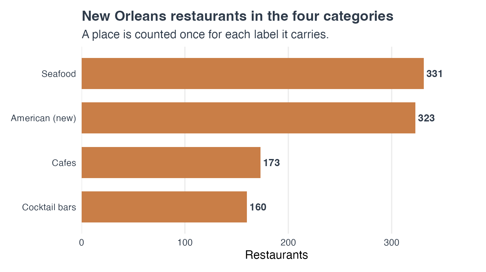
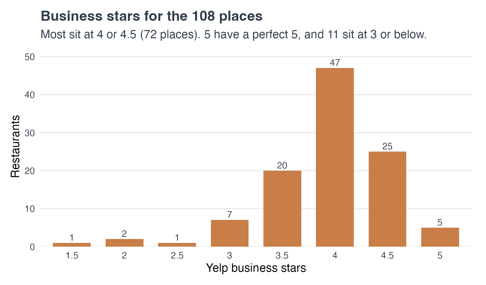
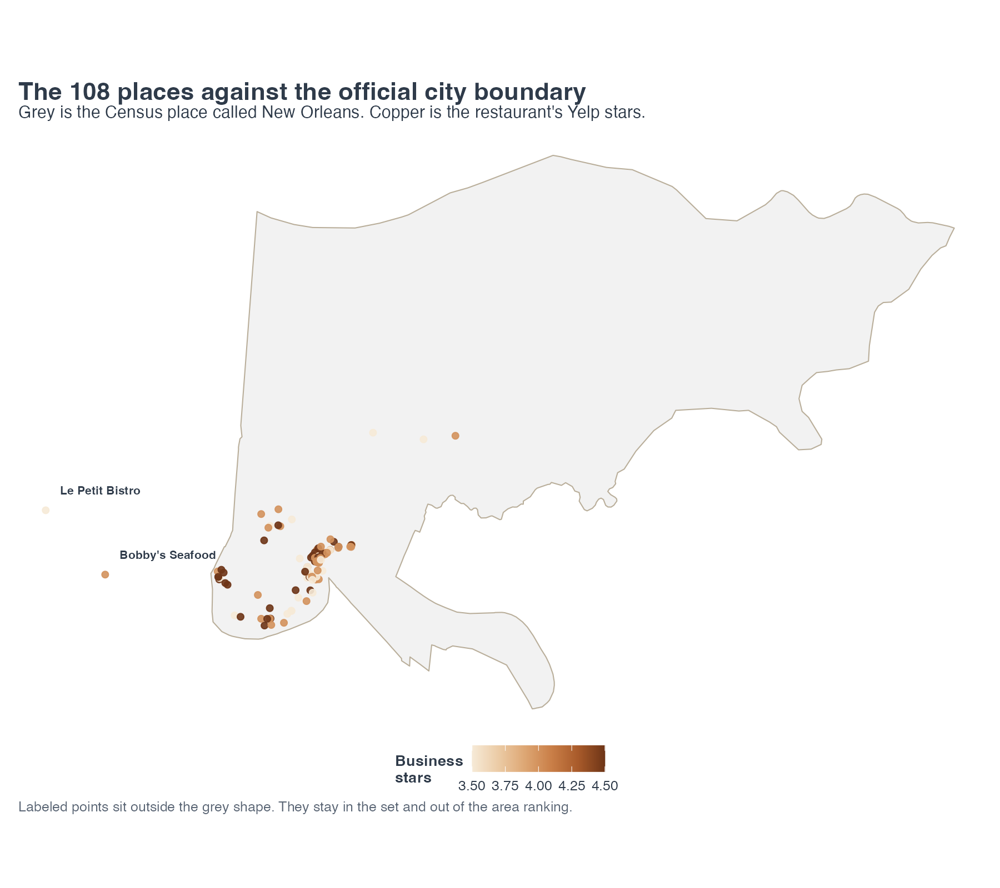
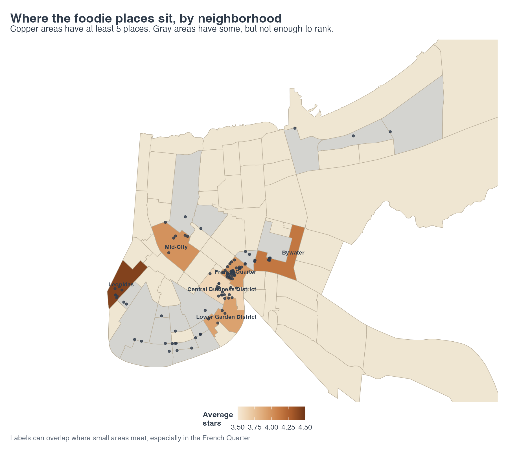
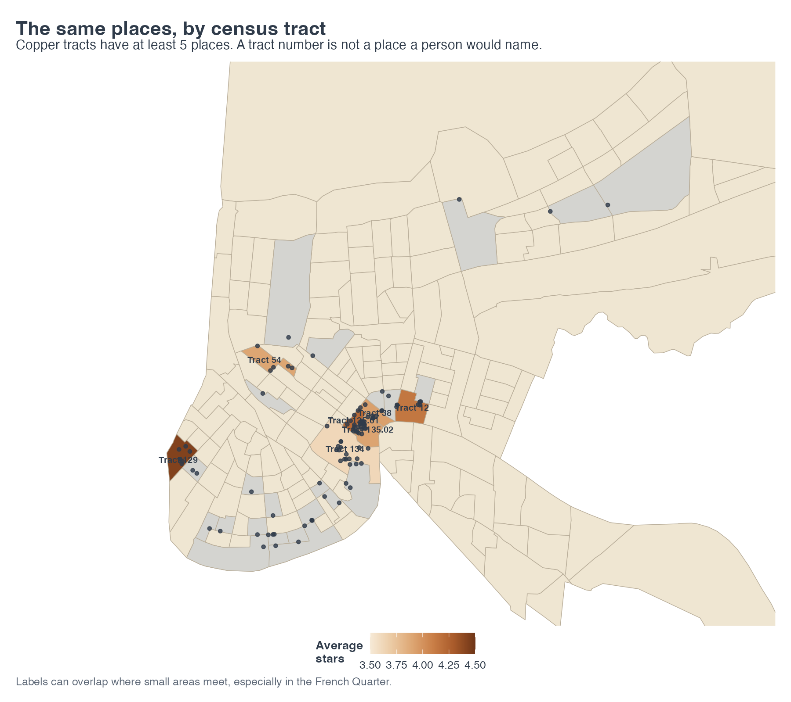
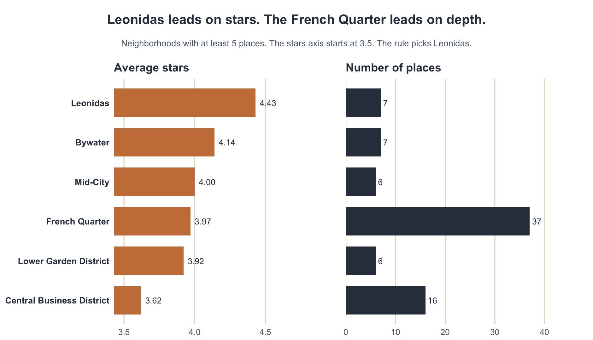

Where can a foodie find local, creative places to stay for a meal, a drink, or seafood in New Orleans, and which neighborhood is best when an area needs at least five of those places?

## Overview

I kept a restaurant only when three things were true. It had to have at least one of four Yelp categories: American (new), cocktail bars, cafes, or seafood. Its name could appear at most twice among the 2,259 New Orleans restaurants. And at least 5% of its reviews had to use one of these words: fusion, handmade, courtyard, mural, seasonal, inventive, or omakase. That leaves 108 places.

Neighborhood Statistical Areas are the map. Census tracts are the comparison. An area is ranked only when it has at least five of these places. The highest average business stars wins. The number of places is the tie-breaker. Leonidas is first, with 7 places and an average of 4.43 stars. The French Quarter has more places, 37, and a lower average, 3.97.

```{r}
#| label: setup
#| include: false

library(dplyr)
library(knitr)
```

## New Orleans restaurants

A business counts as a New Orleans restaurant when `state` is LA, `city` is New Orleans, and the categories text contains "Restaurants". That work is in `R/import.R`. This page reads the saved files. It does not import the raw JSON again.

```{r}
#| label: import-counts

# Row counts from the saved files
business <- readRDS("data/new_orleans/business_new_orleans.rds")
reviews <- readRDS("data/new_orleans/reviews_new_orleans.rds")

data.frame(
  Restaurants = nrow(business),
  Reviews = nrow(reviews)
) |>
  kable(booktabs = TRUE)
```

That filter leaves 2,259 restaurants and 476,421 reviews. Every review belongs to one of those restaurants.

The review file is about 5 GB. My laptop has 8 GB of RAM, so `R/import.R` does not load it all at once. `jsonlite::stream_in()` reads it in pages of 100,000 reviews and keeps only the reviews for these restaurants. The raw JSON is not in the repo. The download steps are in `README.md`.

## The four categories

The four labels are American (new), cocktail bars, cafes, and seafood. I picked them because they are ways to stay for a meal, a drink, or seafood. A restaurant needs only one label to enter the set.

```{r}
#| label: category-counts

category_labels <- c(
  "seafood" = "Seafood",
  "american (new)" = "American (new)",
  "cafes" = "Cafes",
  "cocktail bars" = "Cocktail bars"
)

category_counts <- read.csv("data/new_orleans/category_counts.csv") |>
  mutate(category = category_labels[category])

kable(
  category_counts,
  col.names = c("Category", "Restaurants"),
  booktabs = TRUE
)
```

```{r}
#| label: fig-categories
#| fig-cap: "New Orleans restaurants in each of the four categories. A place is counted once for each label."
#| out-width: "100%"


```

Seafood is the largest label, at 331 restaurants. American (new) has 323, cafes have 173, and cocktail bars have 160. A place is counted once for each label it carries, so one restaurant can land in more than one of those totals.

The same restaurant can carry two of the labels. A seafood place with no cocktail bar still counts, because one label is enough.

```{r}
#| label: category-pairs

category_pairs <- read.csv("data/new_orleans/category_pairs.csv") |>
  mutate(
    category_a = category_labels[category_a],
    category_b = category_labels[category_b]
  )

kable(
  category_pairs,
  col.names = c("Category", "Also has", "Restaurants"),
  booktabs = TRUE,
  caption = "Restaurants that carry both labels."
)
```

American (new) and cocktail bars share 51 restaurants. American (new) and seafood share 45. Cocktail bars and seafood share 30. American (new) and cafes share 26. Cafes and cocktail bars share 13. Cafes and seafood share 5.

The category rule alone leaves 834 restaurants.

I counted a name as a chain when it appears more than twice among all 2,259 New Orleans restaurants. The match is the exact name after lowercasing and squishing extra spaces, so "Wow Cafe" and "WOW Cafe" are one name. When a name shows up three or more times, every theme restaurant with that name comes out. Ruby Slipper Cafe and Dat Dog come out, and so does Waffle House. Raising Cane's has five shops in the city and only one of them was in the theme, so that one shop is still removed. The count is the whole city. "WOW Café", with an accent, is a different string from "WOW Cafe", so the accented name is not part of that chain.

```{r}
#| label: chains

chains <- read.csv("data/new_orleans/chains_removed.csv")

kable(
  chains,
  col.names = c("Name", "Locations in the city", "Removed from the theme"),
  booktabs = TRUE
)
```

That removes 37 restaurants and leaves 797.

The last rule is the review text. I tried common words and dropped them, because chef, tasting, homemade, patio, and creative show up almost everywhere. The words I kept are fusion, handmade, courtyard, mural, seasonal, inventive, and omakase. A restaurant stays when at least 5% of its reviews use one of them. Any of the seven words can clear that line.

```{r}
#| label: filter-counts

filter_counts <- read.csv("data/new_orleans/filter_counts.csv")

kable(
  filter_counts,
  col.names = c("Step", "Restaurants left"),
  booktabs = TRUE
)
```

The category rule leaves 834. The chain rule leaves 797. The word rule leaves 108.

The 108 places sit in 13 postal codes.

```{r}
#| label: fig-stars
#| fig-cap: "Business stars for the 108 places. Most sit at 4 or 4.5."
#| out-width: "100%"


```

72 of the 108 sit at 4 or 4.5. Five places have a perfect 5, and 11 sit at 3 or below.

## Joining the reviews

The review file is filtered to these 108 `business_id`s. Each restaurant gets a review count, the mean of the review stars, and the median of the review stars. Those columns are saved in `data/new_orleans/selected_with_reviews.rds`. The table is the first eight names, in alphabetical order.

```{r}
#| label: review-head

review_head <- readRDS("data/new_orleans/selected_with_reviews.rds") |>
  transmute(
    Restaurant = business_name,
    `Business stars` = stars,
    `Review rows` = n_reviews,
    `Mean of review stars` = mean_review_stars,
    `Median of review stars` = median_review_stars
  ) |>
  arrange(Restaurant) |>
  slice_head(n = 8)

kable(review_head, digits = 2, booktabs = TRUE)
```

Business stars and the mean of the review stars differ for 100 of the 108 places. The typical gap is about 0.12 stars.

## The city polygon

Yelp's `city` field is a text label. The Census place polygon is a separate boundary. `R/places.R` turns the 2,259 restaurants into points and joins them to 2023 Census places with `st_within`. Every restaurant had coordinates. I kept every mismatch in the data.

```{r}
#| label: city-vs-place

city_vs_place <- read.csv("data/new_orleans/city_vs_place.csv")

kable(
  city_vs_place,
  col.names = c("Yelp city", "Census place", "Restaurants"),
  booktabs = TRUE
)
```

2,202 of the 2,259 Yelp "New Orleans" points are inside the city polygon. The other 57 are in Elmwood, Jefferson, Harahan, Terrytown, Metairie, River Ridge, Arabi, Harvey, Gretna, or Kenner. Yelp still calls every one of them New Orleans.

```{r}
#| label: mismatch-examples

examples <- read.csv("data/new_orleans/place_mismatch_examples.csv")

kable(
  examples,
  col.names = c("Restaurant", "Address", "Postal code", "Census place"),
  booktabs = TRUE,
  caption = "One example from each Census place that is not New Orleans."
)
```

Le Petit Bistro has 1.5 stars, postal code 70115, a blank address, and coordinates in Kenner. That is a bad geocode. Bobby's Seafood has 4.0 stars, the address 9013 Jefferson Hwy, and postal code 70123. That address is in River Ridge, and Yelp still filed it under New Orleans.

Of the 108 places, 106 are inside the city. Those two are the ones outside it.

```{r}
#| label: fig-city
#| fig-cap: "The 108 places against the official New Orleans boundary. Labeled points fall outside the city."
#| out-width: "100%"


```

Grey is the Census city. Copper is the restaurant's own Yelp stars. The labeled points are Le Petit Bistro and Bobby's Seafood.

## Neighborhoods and tracts

Neighborhoods are the geography for the question. Census tracts are the comparison. Both layers are joined with `st_within`. The neighborhood names come from `gnocdc_lab`, put into title case. An area is ranked only with at least five places. The highest average business stars wins, and the count of places is the tie-breaker. Areas with fewer than five are drawn in gray and left out of the ranking.

```{r}
#| label: area-comparison

comparison <- read.csv("data/new_orleans/area_comparison.csv")

kable(
  comparison,
  col.names = c(
    "Geographic system",
    "Areas in the layer",
    "Areas with a place",
    "Areas with at least 5",
    "Restaurants assigned",
    "Unmatched",
    "Smallest area",
    "Largest area"
  ),
  booktabs = TRUE
)
```

Neighborhoods: 72 areas, 23 with a place, 6 with at least 5, 106 assigned, 2 unmatched, counts from 1 to 37. Tracts: 184 areas, 30 with a place, 7 with at least 5, the same 106 assigned, the same 2 unmatched, counts from 1 to 23.

The two unmatched restaurants are Le Petit Bistro and Bobby's Seafood. Their coordinates fall outside both polygon layers, which cover Orleans Parish. They stay in the set of 108. The ranking leaves them out.

106 of the 108 fall in 23 neighborhoods. That meets the assignment check of at least 10 restaurants in at least 7 areas.

```{r}
#| label: fig-neighborhoods
#| fig-cap: "Neighborhoods with at least five places are copper, by average stars. Gray means the area has some of these places and fewer than five. Sand means none."
#| out-width: "100%"


```

The six copper neighborhoods are the ranking. Gray neighborhoods have at least one of these places and fewer than five, so they are left out. Read Blvd East, Pines Village, and West Lake Forest each have one place. The map is cropped to areas that contain at least one place, with extra room on the left so the Leonidas label is not cut off. Labels in the Quarter can sit on top of each other.

```{r}
#| label: fig-tracts
#| fig-cap: "The same places, divided into census tracts. Copper tracts have at least five places."
#| out-width: "100%"


```

Tract 129 is the Leonidas cluster, the same 7 places at 4.43. Tract 12 matches Bywater. Tract 134 matches the Central Business District, 16 places at 3.62. In the French Quarter, Tract 135.02 has 23 places at 3.91 and Tract 135.01 has 7 at 4.21. Those Quarter labels overlap on the map.

```{r}
#| label: fig-ranking
#| fig-cap: "Neighborhoods with at least five places. Leonidas has the highest average stars. The French Quarter has the most places. The stars axis starts at 3.5."
#| out-width: "100%"


```

Leonidas has the highest average. The French Quarter has the most places. The stars axis starts at 3.5, so 4.43 and 3.97 are easier to tell apart.

```{r}
#| label: ranking-table

ranking <- read.csv("data/new_orleans/neighborhood_ranking.csv") |>
  transmute(
    Neighborhood = area_name,
    Places = restaurants,
    `Average stars` = sprintf("%.2f", average_stars),
    `Median review count` = ifelse(
      abs(median_review_count - round(median_review_count)) < 1e-8,
      sprintf("%d", as.integer(round(median_review_count))),
      sprintf("%.1f", median_review_count)
    )
  )

kable(
  ranking,
  booktabs = TRUE,
  align = "lrrr",
  caption = "Neighborhoods with at least five places. The median is the median of the Yelp review counts."
)
```

Leonidas has 7 places, an average of 4.43, and a median of 51 reviews. Bywater also has 7 places, an average of 4.14, and a median of 160. Mid-City has 6 at 4.00, median 61. The French Quarter has 37 at 3.97, median 128. The Lower Garden District has 6 at 3.92, median 61.5. The Central Business District has 16 at 3.62, median 67.

I used neighborhoods because those are names a person asks for. Leonidas, Bywater, and the French Quarter are names. Tract 129 is the same Leonidas cluster, 7 places at 4.43. Tract 12 is Bywater. Tract 134 is the Central Business District, 16 places at 3.62. The tracts split the French Quarter. Tract 135.02 has 23 places at 3.91, and Tract 135.01 has 7 at 4.21. The neighborhood average rolls the Quarter into 37 places at 3.97. The rule picks Leonidas because 4.43 is higher than 3.97.

## Limitations

The word list is a rough way to mark a creative place. For a place with 20 or fewer reviews, one review that uses a list word clears 5%. 29 of the 108 are in that range. Golden Feather Mardi Gras Indian Restaurant Gallery has five reviews, one hit, and 5 business stars.

The chain rule is the exact name after lowercasing and squishing. "WOW Café", with an accent, is a different string from "WOW Cafe". "WOW Cafe - Tulane & Galvez" is its own string too. Neither of those two strings is in the final 108.

Le Petit Bistro and Bobby's Seafood fall outside both polygon layers. They stay in the set of 108. The ranking leaves them out.

The ranking uses Yelp's business stars.

## Sources

- Yelp Open Dataset, filtered in `R/import.R`. The raw JSON is not in the repo.
- Neighborhood Statistical Areas from [Data.NOLA.gov](https://data.nola.gov/api/v3/views/exvn-jeh2/query.geojson?accessType=DOWNLOAD), saved as `data/geo/neighborhoods.geojson`. The name field is `gnocdc_lab`.
- 2023 Census tracts and places, cartographic boundary files, through `tigris`.
