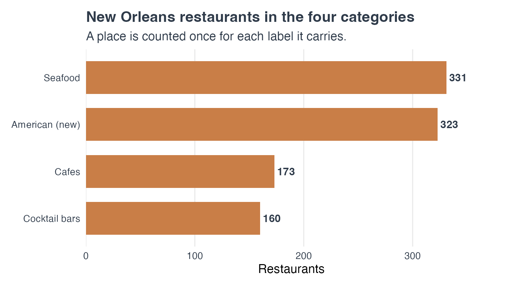
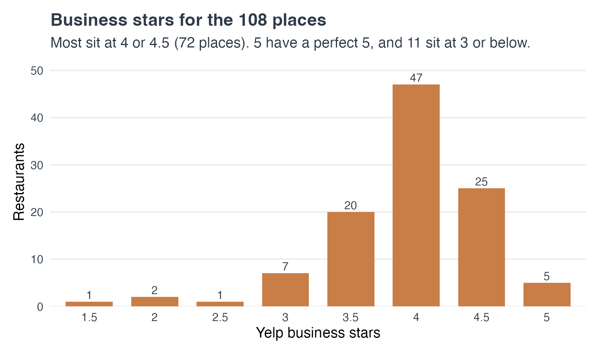
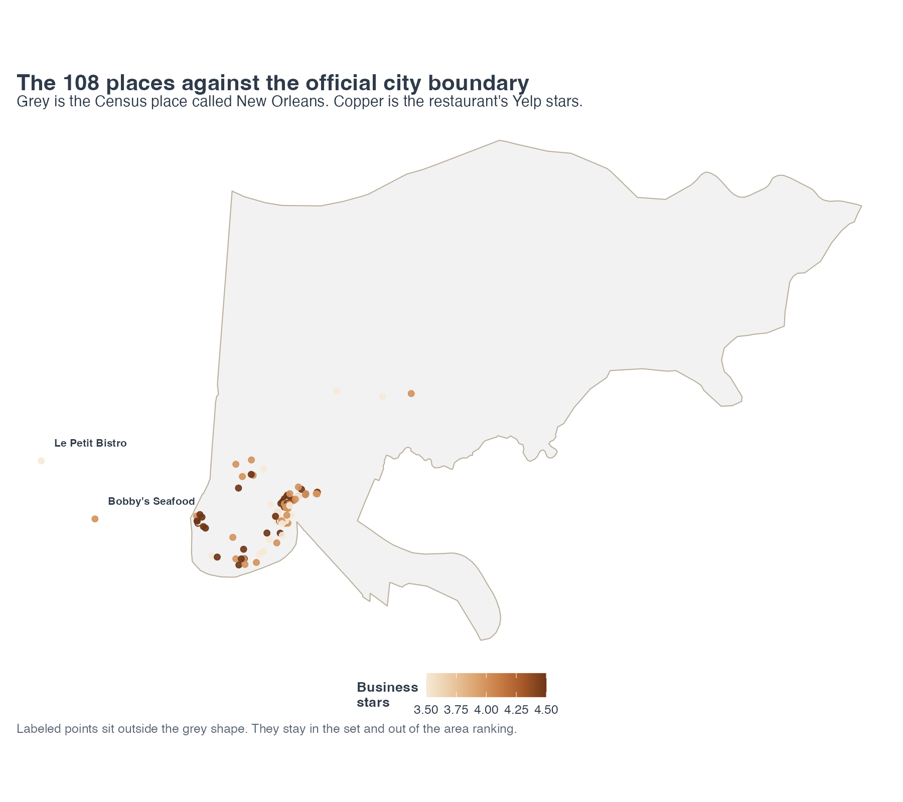
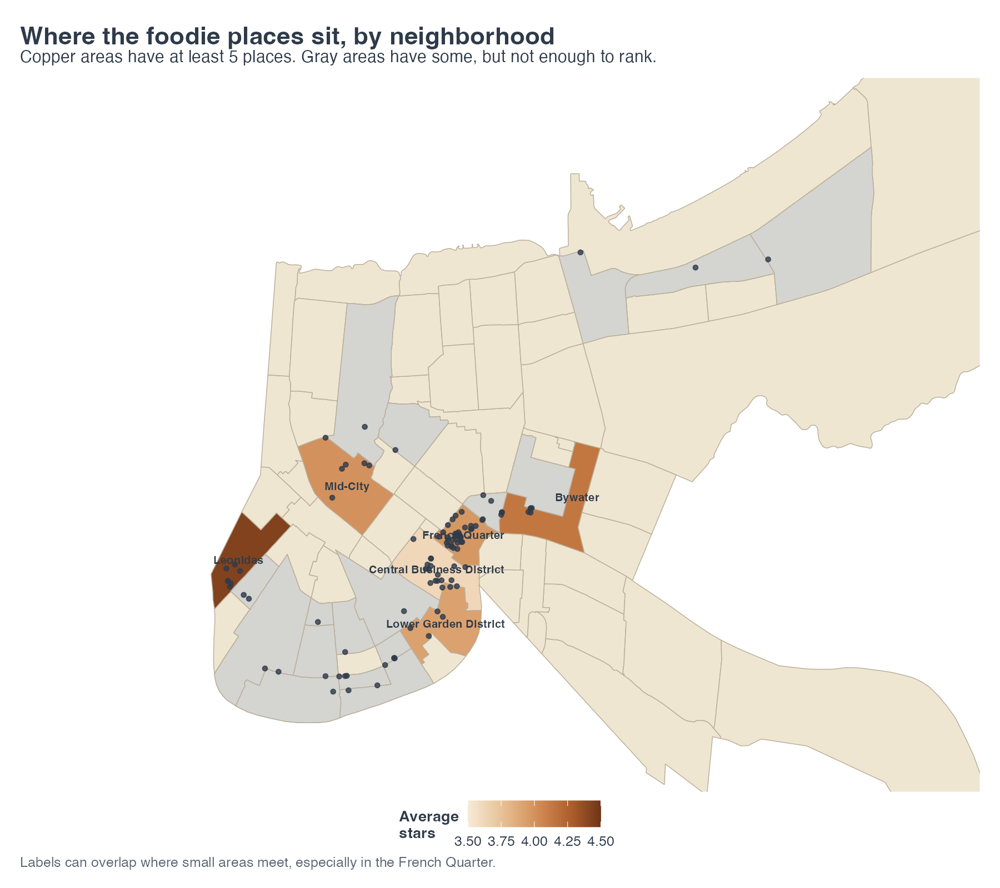
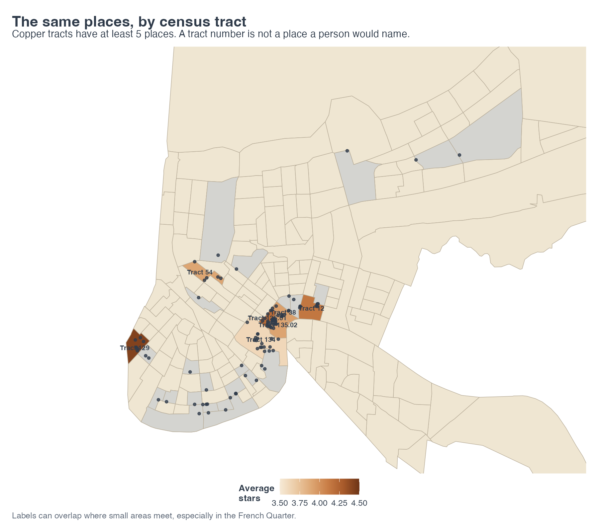
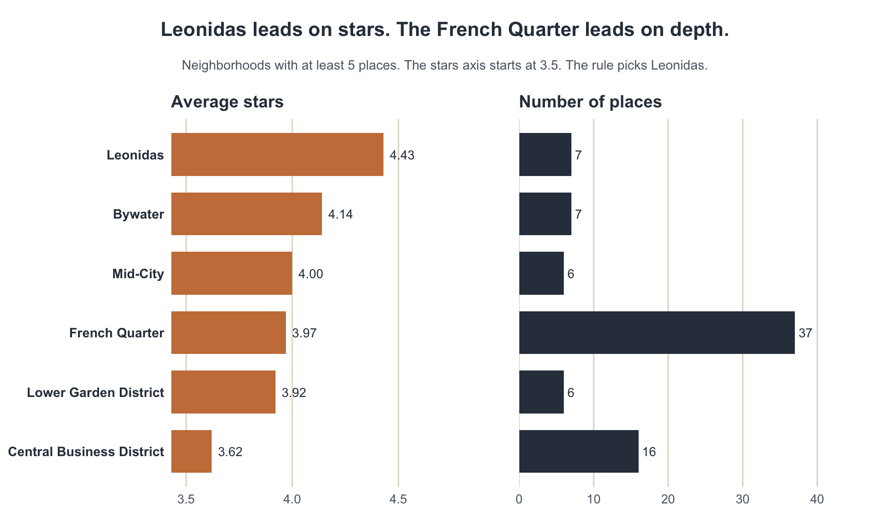
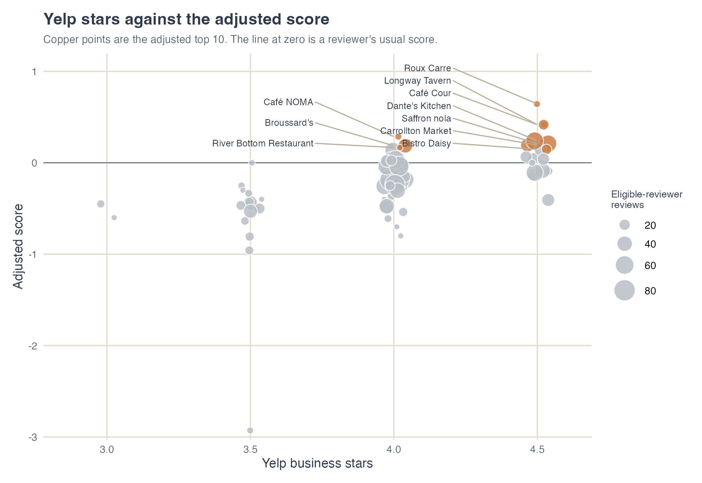
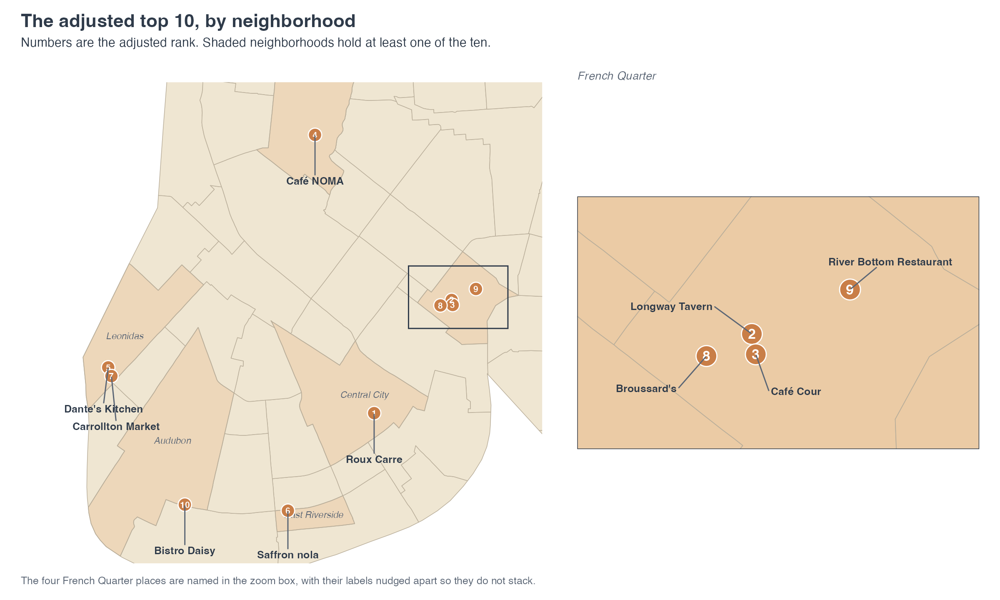

Where can a foodie find local, creative places to stay for a meal, a drink, or seafood in New Orleans, which ten places rank first, and which neighborhood is best when an area needs at least five of those places?

## Overview

I wanted a meal, a drink, or seafood in a place that still felt local, so those four labels are the start of the set.

I kept a restaurant only when three things were true. It had to have at least one of four Yelp categories: American (new), cocktail bars, cafes, or seafood. Its name could appear at most twice among the 2,259 New Orleans restaurants. And at least 5% of its reviews had to use one of these words: fusion, handmade, courtyard, mural, seasonal, inventive, or omakase. That leaves 108 places.

Neighborhood Statistical Areas are the map. Census tracts are the comparison. An area is ranked only when it has at least five of these places. The highest average business stars wins. The number of places is the tie-breaker. Leonidas is first, with 7 places and an average of 4.43 stars. The French Quarter has more places, 37, and a lower average, 3.97.

The adjusted top 10 starts with Roux Carre. Under the stars rule, Leonidas is the best neighborhood. Under the adjusted rule, which needs 5 places with an adjusted score and averages those scores, the French Quarter is first, at -0.14 over 23 places.

```{r}
#| label: setup
#| include: false

# Load the two packages the page uses
library(dplyr)
library(knitr)
```

## New Orleans restaurants

A business counts as a New Orleans restaurant when `state` is LA, `city` is New Orleans, and the categories text contains "Restaurants". That work is in `R/import.R`. This page reads the saved files. It does not import the raw JSON again.

```{r}
#| label: import-counts

# Row counts from the saved files
business <- readRDS("data/new_orleans/business_new_orleans.rds")
reviews <- readRDS("data/new_orleans/reviews_new_orleans.rds")

data.frame(
  Restaurants = nrow(business),
  Reviews = nrow(reviews)
) |>
  kable(booktabs = TRUE)
```

That filter leaves 2,259 restaurants and 476,421 reviews. Every review belongs to one of those restaurants.

The review file is about 5 GB. My laptop has 8 GB of RAM, so `R/import.R` does not load it all at once. `jsonlite::stream_in()` reads it in pages of 100,000 reviews and keeps only the reviews for these restaurants. The raw JSON is not in the repo. The download steps are in `README.md`.

## The four categories

The four labels are American (new), cocktail bars, cafes, and seafood. I picked them because they are ways to stay for a meal, a drink, or seafood. A restaurant needs only one label to enter the set.

```{r}
#| label: category-counts

# Category counts from the saved file, with readable labels
category_labels <- c(
  "seafood" = "Seafood",
  "american (new)" = "American (new)",
  "cafes" = "Cafes",
  "cocktail bars" = "Cocktail bars"
)

category_counts <- read.csv("data/new_orleans/category_counts.csv") |>
  mutate(category = category_labels[category])

kable(
  category_counts,
  col.names = c("Category", "Restaurants"),
  booktabs = TRUE
)
```

```{r}
#| label: fig-categories
#| fig-cap: "New Orleans restaurants in each of the four categories. A place is counted once for each label."
#| out-width: "100%"

# Figure made in R/categories.R

```

Seafood is the largest label, at 331 restaurants. American (new) has 323, cafes have 173, and cocktail bars have 160. A place is counted once for each label it carries, so one restaurant can land in more than one of those totals.

The same restaurant can carry two of the labels. A seafood place with no cocktail bar still counts, because one label is enough.

```{r}
#| label: category-pairs

# Pair counts from the saved file
category_pairs <- read.csv("data/new_orleans/category_pairs.csv") |>
  mutate(
    category_a = category_labels[category_a],
    category_b = category_labels[category_b]
  )

kable(
  category_pairs,
  col.names = c("Category", "Also has", "Restaurants"),
  booktabs = TRUE,
  caption = "Restaurants that carry both labels."
)
```

American (new) and cocktail bars share 51 restaurants. American (new) and seafood share 45. Cocktail bars and seafood share 30. American (new) and cafes share 26. Cafes and cocktail bars share 13. Cafes and seafood share 5.

The category rule alone leaves 834 restaurants.

I counted a name as a chain when it appears more than twice among all 2,259 New Orleans restaurants. The match is the exact name after lowercasing and squishing extra spaces, so "Wow Cafe" and "WOW Cafe" are one name. When a name shows up three or more times, every theme restaurant with that name comes out. Ruby Slipper Cafe and Dat Dog come out, and so does Waffle House. Raising Cane's has five shops in the city and only one of them was in the theme, so that one shop is still removed. The count is the whole city. "WOW Café", with an accent, is a different string from "WOW Cafe", so the accented name is not part of that chain.

```{r}
#| label: chains

# Names removed by the chain rule
chains <- read.csv("data/new_orleans/chains_removed.csv")

kable(
  chains,
  col.names = c("Name", "Locations in the city", "Removed from the theme"),
  booktabs = TRUE
)
```

That removes 37 restaurants and leaves 797.

The last rule is the review text. I tried common words and dropped them, because chef, tasting, homemade, patio, and creative show up almost everywhere. The words I kept are fusion, handmade, courtyard, mural, seasonal, inventive, and omakase. A restaurant stays when at least 5% of its reviews use one of them. Any of the seven words can clear that line.

```{r}
#| label: filter-counts

# Restaurants left after each rule
filter_counts <- read.csv("data/new_orleans/filter_counts.csv")

kable(
  filter_counts,
  col.names = c("Step", "Restaurants left"),
  booktabs = TRUE
)
```

The category rule leaves 834. The chain rule leaves 797. The word rule leaves 108.

The 108 places sit in 13 postal codes.

```{r}
#| label: fig-stars
#| fig-cap: "Business stars for the 108 places. Most sit at 4 or 4.5."
#| out-width: "100%"

# Figure made in R/categories.R

```

72 of the 108 sit at 4 or 4.5. Five places have a perfect 5, and 11 sit at 3 or below.

## Joining the reviews

The review file is filtered to these 108 `business_id`s. Each restaurant gets a review count, the mean of the review stars, and the median of the review stars. Those columns are saved in `data/new_orleans/selected_with_reviews.rds`. The table is the first eight names, in alphabetical order.

```{r}
#| label: review-head

# First eight of the 108, with their review columns
review_head <- readRDS("data/new_orleans/selected_with_reviews.rds") |>
  transmute(
    Restaurant = business_name,
    `Business stars` = stars,
    `Review rows` = n_reviews,
    `Mean of review stars` = mean_review_stars,
    `Median of review stars` = median_review_stars
  ) |>
  arrange(Restaurant) |>
  slice_head(n = 8)

kable(review_head, digits = 2, booktabs = TRUE)
```

Business stars and the mean of the review stars differ for 100 of the 108 places. The typical gap is about 0.12 stars.

## The city polygon

Yelp's `city` field is a text label. The Census place polygon is a separate boundary. `R/places.R` turns the 2,259 restaurants into points and joins them to 2023 Census places with `st_within`. Every restaurant had coordinates. I kept every mismatch in the data.

```{r}
#| label: city-vs-place

# Yelp city against the Census place, from R/places.R
city_vs_place <- read.csv("data/new_orleans/city_vs_place.csv")

kable(
  city_vs_place,
  col.names = c("Yelp city", "Census place", "Restaurants"),
  booktabs = TRUE
)
```

2,202 of the 2,259 Yelp "New Orleans" points are inside the city polygon. The other 57 are in Elmwood, Jefferson, Harahan, Terrytown, Metairie, River Ridge, Arabi, Harvey, Gretna, or Kenner. Yelp still calls every one of them New Orleans.

```{r}
#| label: mismatch-examples

# One example restaurant per Census place that is not New Orleans
examples <- read.csv("data/new_orleans/place_mismatch_examples.csv")

kable(
  examples,
  col.names = c("Restaurant", "Address", "Postal code", "Census place"),
  booktabs = TRUE,
  caption = "One example from each Census place that is not New Orleans."
)
```

Le Petit Bistro has 1.5 stars, postal code 70115, a blank address, and coordinates in Kenner. That is a bad geocode. Bobby's Seafood has 4.0 stars, the address 9013 Jefferson Hwy, and postal code 70123. That address is in River Ridge, and Yelp still filed it under New Orleans.

Of the 108 places, 106 are inside the city. Those two are the ones outside it.

```{r}
#| label: fig-city
#| fig-cap: "The 108 places against the official New Orleans boundary. Labeled points fall outside the city."
#| out-width: "100%"

# Figure made in R/places.R

```

Grey is the Census city. Copper is the restaurant's own Yelp stars. The labeled points are Le Petit Bistro and Bobby's Seafood.

## Neighborhoods and tracts

Neighborhoods are the geography for the question. Census tracts are the comparison. Both layers are joined with `st_within`. The neighborhood names come from `gnocdc_lab`, put into title case. An area is ranked only with at least five places. The highest average business stars wins, and the count of places is the tie-breaker. Areas with fewer than five are drawn in gray and left out of the ranking.

```{r}
#| label: area-comparison

# Neighborhoods and tracts side by side, from R/areas.R
comparison <- read.csv("data/new_orleans/area_comparison.csv")

kable(
  comparison,
  col.names = c(
    "Geographic system",
    "Areas in the layer",
    "Areas with a place",
    "Areas with at least 5",
    "Restaurants assigned",
    "Unmatched",
    "Smallest area",
    "Largest area"
  ),
  booktabs = TRUE
)
```

Neighborhoods: 72 areas, 23 with a place, 6 with at least 5, 106 assigned, 2 unmatched, counts from 1 to 37. Tracts: 184 areas, 30 with a place, 7 with at least 5, the same 106 assigned, the same 2 unmatched, counts from 1 to 23.

The two unmatched restaurants are Le Petit Bistro and Bobby's Seafood. Their coordinates fall outside both polygon layers, which cover Orleans Parish. They stay in the set of 108. The ranking leaves them out.

106 of the 108 fall in 23 neighborhoods. That meets the assignment check of at least 10 restaurants in at least 7 areas.

```{r}
#| label: fig-neighborhoods
#| fig-cap: "Neighborhoods with at least five places are copper, by average stars. Gray means the area has some of these places and fewer than five. Sand means none."
#| out-width: "100%"

# Figure made in R/areas.R

```

The six copper neighborhoods are the ranking. Gray neighborhoods have at least one of these places and fewer than five, so they are left out. Read Blvd East, Pines Village, and West Lake Forest each have one place. The map is cropped to areas that contain at least one place, with extra room on the left so the Leonidas label is not cut off. Labels in the Quarter can sit on top of each other.

```{r}
#| label: fig-tracts
#| fig-cap: "The same places, divided into census tracts. Copper tracts have at least five places."
#| out-width: "100%"

# Figure made in R/areas.R

```

Tract 129 is the Leonidas cluster, the same 7 places at 4.43. Tract 12 matches Bywater. Tract 134 matches the Central Business District, 16 places at 3.62. In the French Quarter, Tract 135.02 has 23 places at 3.91 and Tract 135.01 has 7 at 4.21. Those Quarter labels overlap on the map.

```{r}
#| label: fig-ranking
#| fig-cap: "Neighborhoods with at least five places. Leonidas has the highest average stars. The French Quarter has the most places. The stars axis starts at 3.5."
#| out-width: "100%"

# Figure made in R/areas.R

```

Leonidas has the highest average. The French Quarter has the most places. The stars axis starts at 3.5, so 4.43 and 3.97 are easier to tell apart.

```{r}
#| label: ranking-table

# Neighborhood ranking under the stars rule, from R/areas.R
ranking <- read.csv("data/new_orleans/neighborhood_ranking.csv") |>
  transmute(
    Neighborhood = area_name,
    Places = restaurants,
    `Average stars` = sprintf("%.2f", average_stars),
    `Median review count` = ifelse(
      abs(median_review_count - round(median_review_count)) < 1e-8,
      sprintf("%d", as.integer(round(median_review_count))),
      sprintf("%.1f", median_review_count)
    )
  )

kable(
  ranking,
  booktabs = TRUE,
  align = "lrrr",
  caption = "Neighborhoods with at least five places. The median is the median of the Yelp review counts."
)
```

Leonidas has 7 places, an average of 4.43, and a median of 51 reviews. Bywater also has 7 places, an average of 4.14, and a median of 160. Mid-City has 6 at 4.00, median 61. The French Quarter has 37 at 3.97, median 128. The Lower Garden District has 6 at 3.92, median 61.5. The Central Business District has 16 at 3.62, median 67.

I used neighborhoods because those are names a person asks for. Leonidas, Bywater, and the French Quarter are names. Tract 129 is the same Leonidas cluster, 7 places at 4.43. Tract 12 is Bywater. Tract 134 is the Central Business District, 16 places at 3.62. The tracts split the French Quarter. Tract 135.02 has 23 places at 3.91, and Tract 135.01 has 7 at 4.21. The neighborhood average rolls the Quarter into 37 places at 3.97. The rule picks Leonidas because 4.43 is higher than 3.97.

## Reviewers kept

Yelp stars are the rating on the business.

The adjusted score uses only people who reviewed at least 5 of the 108 places. I used each person's median as their usual score, because one 1-star or one 5-star review should not reset their habit. For each review I subtracted that median from the stars they gave. The place's adjusted score is the average of those gaps. Above zero means the place beat their habit. Zero means it matched. Below zero means it fell short. This is not a new Yelp rating.

I counted a reviewer's activity only inside the 108. A place can appear on either top 10, and can receive an adjusted score, only when at least 5 of its reviews come from those eligible reviewers. There is no other floor on the review count. The code is in `R/reviewers.R`. It reads the saved files and does not import the raw JSON again.

```{r}
#| label: reviewers-kept

# Reviewers kept at a bar of 5 and at a bar of 10, from R/reviewers.R
kept <- read.csv("data/new_orleans/reviewers_kept.csv") |>
  transmute(
    `Reviewer bar` = bar,
    `Reviewers kept` = format(reviewers_kept, big.mark = ","),
    `Reviews they wrote` = format(reviews_by_them, big.mark = ","),
    `Share of reviews of the 108` = sprintf("%.1f%%", 100 * share_of_reviews)
  )

kable(kept, booktabs = TRUE, align = "rrrr")
```

The bar of 5 keeps 229 of 27,559 reviewers, and they wrote 5.2% of the 33,713 reviews of the 108. At a bar of 10 the count falls to 40 reviewers and 1.8% of the reviews, and the adjusted neighborhood winner is still the French Quarter.

70 of the 108 places have an adjusted score. The other 38 stay in the 108 and in the stars ranking. Le Petit Bistro and Bobby's Seafood are two of the 38.

## The two lists

Both lists use only the 70 places with an adjusted score. The stars list sorts by Yelp stars, then by more eligible-reviewer reviews, then by a higher adjusted score. The adjusted list sorts by the adjusted score, then by more eligible-reviewer reviews, then by higher Yelp stars. The all-reviewer mean is the average of every review of the place. The median gap is the middle of the gaps, and I sorted by the average of the gaps. The two can differ because most reviewers give whole stars, so the middle gap is often 0 while a few large misses pull the average.

```{r}
#| label: top10-stars

# Top 10 by Yelp stars, from R/reviewers.R
top10_stars <- read.csv("data/new_orleans/top10_stars.csv") |>
  transmute(
    Rank = rank,
    Restaurant = business_name,
    Neighborhood = area_name,
    `Yelp stars` = stars,
    `All-reviewer mean` = mean_stars_all,
    `Eligible reviews` = eligible_reviews,
    `Adjusted score` = adjusted_score,
    `Median gap` = median_gap
  )

kable(
  top10_stars,
  digits = c(0, 0, 0, 1, 2, 0, 2, 2),
  booktabs = TRUE,
  align = "rllrrrrr",
  caption = "Top 10 by Yelp stars, among the 70 places with an adjusted score."
)
```

Seven places are on the stars list and not the adjusted list: Café Amelie, Maypop Restaurant, Sneaky Pickle, The Elysian Bar, Treo, The Bower Bar, and True Food Kitchen. All ten have 4.5 stars, so the order comes from the second rule, the number of eligible-reviewer reviews.

```{r}
#| label: top10-adjusted

# Top 10 by adjusted score, from R/reviewers.R
top10_adjusted <- read.csv("data/new_orleans/top10_adjusted.csv") |>
  transmute(
    Rank = rank,
    Restaurant = business_name,
    Neighborhood = area_name,
    `Yelp stars` = stars,
    `All-reviewer mean` = mean_stars_all,
    `Eligible reviews` = eligible_reviews,
    `Adjusted score` = adjusted_score,
    `Median gap` = median_gap
  )

kable(
  top10_adjusted,
  digits = c(0, 0, 0, 1, 2, 0, 2, 2),
  booktabs = TRUE,
  align = "rllrrrrr",
  caption = "Top 10 by adjusted score. The map shows this list."
)
```

Dante's Kitchen, Saffron nola, and Carrollton Market are on both lists. Seven places are on the adjusted list and not the stars list: Roux Carre, Longway Tavern, Café Cour, Café NOMA, Broussard's, River Bottom Restaurant, and Bistro Daisy. Roux Carre is first at 0.64, on 7 eligible reviews, and it is the only place with a median gap of 1.

## Who moved

Four places on the adjusted list rest on 6 or 7 eligible reviews: Roux Carre, Café Cour, Café NOMA, and River Bottom Restaurant. Café NOMA moves from 48th on stars to 4th, and River Bottom Restaurant from 49th to 9th. With so few reviews, those moves can come from sample size. Roux Carre has 37 reviews in all and 4.54 as its all-reviewer mean, so it was already well liked before the adjustment.

Sneaky Pickle is the clearest drop. It falls from 6th to 51st on 27 eligible reviews, and 3 of the 7 reviewers whose usual score is 5 gave it less. Café Amelie falls from 2nd to 31st and Maypop Restaurant from 4th to 29th, but those are moves inside a tight pack. Their scores, -0.11 and -0.09, are still above the middle of the 70 places, which is -0.19.

The average of the 229 reviewers' usual scores is 4.15 by median and 3.99 by mean. Most gaps therefore sit slightly below zero, and only 21 of the 70 places are above it.

```{r}
#| label: fig-scatter
#| fig-cap: "Yelp stars against the adjusted score for the 70 places with a score. Point size is the number of eligible-reviewer reviews. The line at zero is a reviewer's usual score. Points are nudged sideways so stacked places can be seen."
#| out-width: "100%"

# Figure made in R/reviewers.R

```

Places with 4.5 stars range from -0.41 to 0.64 on the adjusted score. A business rating alone does not say where a place falls against reviewers' own habits. The one place at -2.93 is Sara's Bistro, with 3.5 stars and 7 eligible reviews.

## The adjusted top 10 on the map

```{r}
#| label: fig-top10-map
#| fig-cap: "The adjusted top 10 inside the neighborhood boundaries. The four French Quarter places are named in the zoom box, and their labels are nudged apart so they do not stack."
#| out-width: "100%"

# Figure made in R/reviewers.R

```

Four of the ten are in the French Quarter, and two are in Leonidas, Dante's Kitchen and Carrollton Market. Central City, City Park, East Riverside, and Audubon each hold one. Bistro Daisy sits on the Audubon edge.

## Neighborhoods under both rules

Under the stars rule, a neighborhood needs at least 5 of the 108 places, and its number is the average of their Yelp stars. Under the adjusted rule, it needs at least 5 places that have an adjusted score, and its number is the unweighted average of those scores. The tie-break is more places.

```{r}
#| label: neighborhood-both

# Both neighborhood rankings, from R/reviewers.R
stars_rule <- read.csv("data/new_orleans/neighborhood_stars.csv") |>
  mutate(Rule = "Yelp stars", Score = sprintf("%.2f", score))
adjusted_rule <- read.csv("data/new_orleans/neighborhood_adjusted.csv") |>
  mutate(Rule = "Adjusted score", Score = sprintf("%.2f", score))

bind_rows(stars_rule, adjusted_rule) |>
  transmute(Rule, Neighborhood = area_name, Places = places, Score) |>
  kable(
    booktabs = TRUE,
    align = "llrr",
    caption = "Places are all 108 under the stars rule and the places with an adjusted score under the adjusted rule."
  )
```

Leonidas is first under the stars rule, with 7 places at 4.43. The French Quarter is first under the adjusted rule, with 23 places at -0.14. Leonidas has 4 places with an adjusted score, so it is not in the second ranking. Its other 3 places have fewer than 5 eligible-reviewer reviews. All five neighborhoods in the adjusted ranking are below zero, and the French Quarter sits closest to it. With the reviewer bar at 10, the French Quarter is still first, at -0.02 over 14 places.


## Limitations

The word list is a rough way to mark a creative place. For a place with 20 or fewer reviews, one review that uses a list word clears 5%. 29 of the 108 are in that range. Golden Feather Mardi Gras Indian Restaurant Gallery has five reviews, one hit, and 5 business stars.

The chain rule is the exact name after lowercasing and squishing. "WOW Café", with an accent, is a different string from "WOW Cafe". "WOW Cafe - Tulane & Galvez" is its own string too. Neither of those two strings is in the final 108.

Le Petit Bistro and Bobby's Seafood fall outside both polygon layers. They stay in the set of 108. The ranking leaves them out.

The first neighborhood ranking uses Yelp's business stars. The second uses the adjusted score, which is not a Yelp star. It says whether a review beat that reviewer's median, and nothing about the place beyond that. 38 of the 108 have fewer than 5 eligible-reviewer reviews, so they have no adjusted score. Four of the adjusted top 10 rest on 6 or 7 of those reviews.

## Sources

- Yelp Open Dataset, filtered in `R/import.R`. The raw JSON is not in the repo.
- Neighborhood Statistical Areas from [Data.NOLA.gov](https://data.nola.gov/api/v3/views/exvn-jeh2/query.geojson?accessType=DOWNLOAD), saved as `data/geo/neighborhoods.geojson`. The name field is `gnocdc_lab`.
- 2023 Census tracts and places, cartographic boundary files, through `tigris`.

## Prompt log

The prompts I gave the agent are in [prompts/PROMPT_HISTORY.md](https://github.com/Michaelhamaty/MATH-167R-Project2/blob/main/prompts/PROMPT_HISTORY.md). Each entry has the date, what I asked, and what I decided next. They show the creative options I asked for, the questions that let me add my own rules, and the points where I told the agent what to do.
